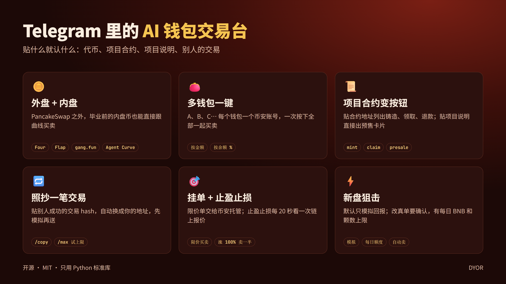

# agent-wallet-tg

用 Telegram 操作你的 **币安 AI 钱包（Binance Agentic Wallet）** 交易 BSC 代币：PancakeSwap 外盘，
以及 Four.meme、Flap、gang.fun V1–V3、Agent Curve 内盘（毕业前直接跟曲线买卖）。底层走币安官方 `baw` 命令行工具。

[English](README.md) · [完整教程（带图）](docs/tutorial.zh-CN.md) · [常见问题 FAQ](docs/FAQ.zh-CN.md)



- **不碰私钥。** 机器人看不到任何私钥或助记词，每笔交易都由 `baw` 在币安那边签名。
- **先预览，再确认。** 每一笔手动买、卖、转账、合约调用都先报价或模拟，你按 ✅ 确认才会送出；预览 90 秒后失效。
- **只认你一个人。** 机器人只回应你自己的 Telegram 账号私聊，其他人发消息一律不理。
- **多钱包一起操作。** 可以加 A、B、C… 多个钱包（每个钱包一个币安账号），一键同时买卖。

> ⚠️ 本软件操作的是真实资金，未经第三方审计。土狗币可能归零，请从小金额开始。以下内容都不构成投资建议。

## 能做什么

| 贴给机器人 / 按按钮 | 得到 |
|---|---|
| 代币地址 | 交易卡片：价格、市值、池子、持有人、安全检查、你的持仓；按钮可以买、卖、挂单、止盈止损 |
| 内盘代币（Four、Flap、gang.fun、Agent Curve） | 同样的卡片，毕业前直接跟内盘曲线买卖 |
| 项目合约地址 | 列出合约能做的动作（铸造、领取、退款…），每个动作都先预览 |
| 项目给 agent 的整段说明 | 直接生成预售／铸造卡片 |
| 别人成功的交易 hash | 「照抄这笔」，自动换成你自己的地址 |

另外还有：限价挂单（币安托管）、每 20 秒检查一次的止盈止损、新盘狙击（有每日额度）、
盈利自动转回主钱包（可选）、对任何合约都能用的 `/fn` `/tx` `/max` `/rules`。

自动功能（止盈止损、狙击、自动转出）**默认全部关闭**，开启时会先让你确认一次。

## 需要准备

- Linux、macOS，或 Windows + WSL2
- Python 3.10 以上（只用标准库，不用 `pip install`）
- Node.js 18 以上，以及币安 AI 钱包命令行：`npm install -g @binance/agentic-wallet`
- Foundry 的 `cast`（只用来读链上数据）：`curl -L https://foundry.paradigm.xyz | bash && foundryup`
- 已开通 Web3 钱包里「AI 钱包（Agentic Wallet）」的币安账号（机器人的每个钱包对应一个币安账号）
- 在 [@BotFather](https://t.me/BotFather) 申请的 Telegram 机器人 token

## 快速开始

```bash
git clone https://github.com/Cryptozwm/agent-wallet-tg.git
cd agent-wallet-tg
mkdir -p ~/.config/agent-wallet-tg
cp env.example ~/.config/agent-wallet-tg/env && chmod 600 ~/.config/agent-wallet-tg/env
# 编辑 env：填 TG_BOT_TOKEN=...，界面中文就把 BOT_LANG 改成 zh
./run.sh            # 让机器人一直跑；日志在 ~/.config/agent-wallet-tg/bot.log
```

1. 给你的机器人随便发一条消息，它会回你的 Telegram ID。
2. 把 ID 填进 env 的 `TG_OWNER_ID=`，然后重启（`pkill -f "python3 -u bot.py"`，`run.sh` 会在 10 秒后自动重开）。
3. 在机器人里按 **📊 钱包状态 → ➕ 添加钱包**，打开链接，用币安 App 确认登录。
   要加钱包 B，就换另一个币安账号再做一次。
4. 要买内盘币或调用合约，先在币安 App 里给这个钱包打开 **开发者模式**。
5. 贴一个代币地址 → 按买入金额 → 看预览 → 按 **✅ 确认买入**。

Windows 用户：在项目文件夹里执行 `install-task.ps1`，就能开机自动在后台启动机器人。

每一步的截图和说明见 [完整教程](docs/tutorial.zh-CN.md)；卡住了先看 [常见问题](docs/FAQ.zh-CN.md)（安装报错、登录、Agent ID、买入被拒、更新与移除）。

## 设置

所有设置都在 `~/.config/agent-wallet-tg/env`（参考 [env.example](env.example)）。
安全上限——`MAX_BNB_PER_WALLET`、`wallets.json` 里的 payout 收款地址——**只能在电脑上改**，Telegram 里改不了。
日常偏好（快捷买金额、滑点、默认钱包、止盈止损）在 ⚙️ 设置 里用按钮改。

## 安全说明

- env 文件要保密（`chmod 600`）。拿到 bot token 的人可以冒充机器人发消息，但只有 `TG_OWNER_ID` 能给它下指令。
- 单一钱包上限对所有手动和自动操作都有效。
- 安全检查风险等级过高的币直接拒绝买入；池子低于 `MIN_LIQUIDITY_USD` 要多按一次才会买。
- 币安有时会要求你在 App 里再确认一次（例如转账到新地址），机器人会提醒你。

## 授权

MIT
