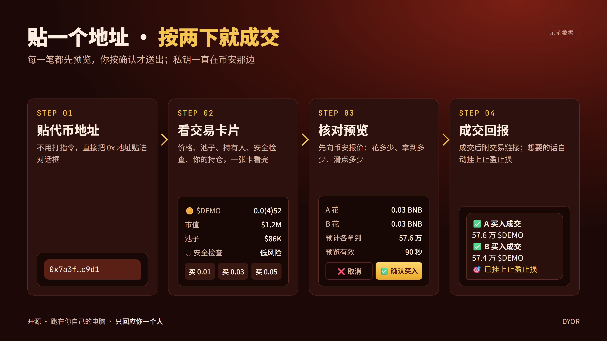
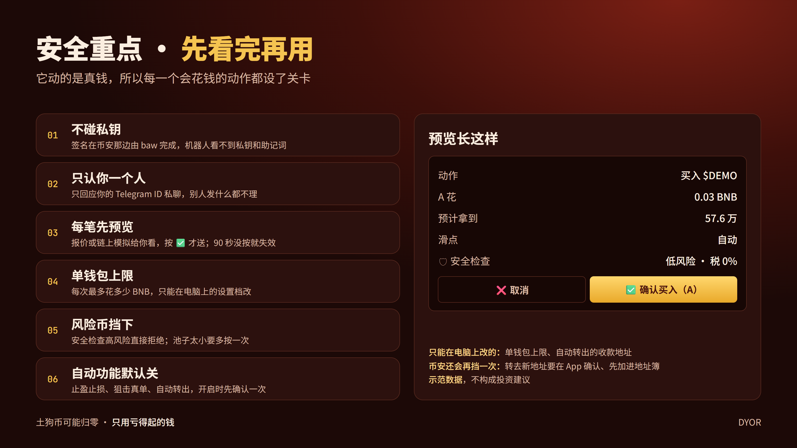
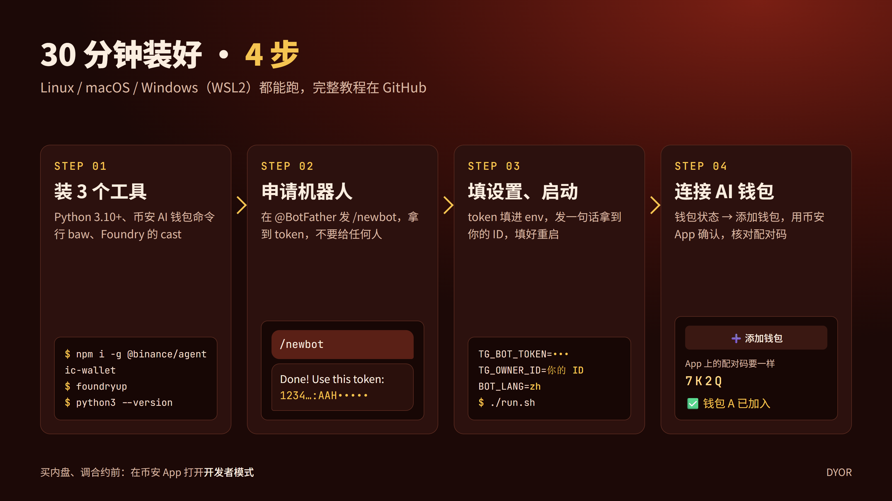

# 完整教程：用 Telegram 操作币安 AI 钱包

这篇教程从零开始，带你把 agent-wallet-tg 跑起来，再一步步讲买卖、挂单、止盈止损、内盘、项目合约和新盘狙击。
大约 30 分钟可以完成安装。

> ⚠️ 本软件操作的是真实资金，未经第三方审计。土狗币可能归零，请从小金额开始。教程里的币和金额都只是示范，不构成投资建议。



## 目录

1. [先搞懂它怎么运作](#1-先搞懂它怎么运作)
2. [准备环境](#2-准备环境)
3. [申请 Telegram 机器人](#3-申请-telegram-机器人)
4. [下载并设置](#4-下载并设置)
5. [第一次启动](#5-第一次启动)
6. [连接 AI 钱包](#6-连接-ai-钱包)
7. [第一次买币](#7-第一次买币)
8. [卖出、挂单、止盈止损](#8-卖出挂单止盈止损)
9. [内盘币（Four、Flap、gang.fun、Agent Curve）](#9-内盘币fourflapgangfunagent-curve)
10. [项目合约：铸造、领取、预售、照抄](#10-项目合约铸造领取预售照抄)
11. [新盘狙击](#11-新盘狙击)
12. [设置、快捷键、自动转出](#12-设置快捷键自动转出)
13. [常见问题](#13-常见问题)
14. [安全清单](#14-安全清单)

---

## 1. 先搞懂它怎么运作

```
你（Telegram）  ──>  机器人（你自己电脑上的 bot.py）  ──>  baw 命令行  ──>  币安 AI 钱包（签名、上链）
```

- **机器人跑在你自己的电脑上**，不是别人的服务器。代码全部公开，你可以自己看。
- **私钥在币安那边**。机器人只是调用币安官方的 `baw` 工具，它看不到私钥，也看不到助记词。
- **每一笔都要你按确认**。机器人先报价或在链上模拟一次，把结果给你看，你按 ✅ 才送出。
- **只认你一个人**。设置好你的 Telegram ID 之后，别人发消息给机器人，它一律不理。



## 2. 准备环境

### Windows 用户：先装 WSL2

用「以管理员身份运行」打开 PowerShell，执行：

```powershell
wsl --install
```

重启电脑后，打开「Ubuntu」，设置用户名和密码。之后所有命令都在 Ubuntu 窗口里执行。

### 安装 Node.js、baw、cast

在 Ubuntu（或 macOS / Linux 终端）里执行：

```bash
# Node.js 20
curl -fsSL https://deb.nodesource.com/setup_20.x | sudo -E bash -
sudo apt install -y nodejs git python3

# 币安 AI 钱包命令行（baw）
sudo npm install -g @binance/agentic-wallet

# Foundry 的 cast（只用来读链上数据，不会用它发交易）
curl -L https://foundry.paradigm.xyz | bash
source ~/.bashrc && foundryup
```

检查一下：

```bash
python3 --version   # 3.10 以上
baw --version
cast --version
```

### 币安账号

- 在币安 App 的 Web3 钱包里开通 **AI 钱包（Agentic Wallet）**。
- 机器人的**每个钱包对应一个币安账号**。只想用一个钱包的话，一个账号就够了。

## 3. 申请 Telegram 机器人

1. 在 Telegram 搜索 [@BotFather](https://t.me/BotFather)，发送 `/newbot`。
2. 按提示取一个名字和一个用户名（必须以 `bot` 结尾）。
3. BotFather 会给你一串 token，长得像 `1234567890:AAH...`。**这串 token 不要给任何人。**

## 4. 下载并设置

```bash
git clone https://github.com/Cryptozwm/agent-wallet-tg.git
cd agent-wallet-tg
mkdir -p ~/.config/agent-wallet-tg
cp env.example ~/.config/agent-wallet-tg/env
chmod 600 ~/.config/agent-wallet-tg/env
nano ~/.config/agent-wallet-tg/env
```

至少改这两行：

```ini
TG_BOT_TOKEN=你在 BotFather 拿到的 token
BOT_LANG=zh
```

其他设置先用默认值就好，之后都可以改：

| 设置 | 默认 | 意思 |
|---|---|---|
| `MAX_BNB_PER_WALLET` | 0.1 | 单一钱包每次最多花多少 BNB（买入、挂单、合约付款都算）。只能在这里改 |
| `SLIPPAGE` | auto | 滑点，auto 由币安决定 |
| `BLOCK_RISK_LEVEL` | 4 | 安全检查风险等级到这个数字就拒绝买入（4 = 高风险） |
| `MIN_LIQUIDITY_USD` | 20000 | 池子小于这个美元数，要多按一次「仍要买」 |
| `CONFIRM_TTL_SECONDS` | 90 | 预览多少秒后失效 |
| `TZ_OFFSET_HOURS` | 8 | 显示时间用的时区（8 = 北京时间） |



## 5. 第一次启动

```bash
./run.sh
```

`run.sh` 会让机器人一直运行，挂掉的话 10 秒后自动重开。日志在 `~/.config/agent-wallet-tg/bot.log`。
想让它在后台跑，可以用 `nohup ./run.sh &`，或用 `tmux`、`screen`。

**拿到你的 Telegram ID：**

1. 在 Telegram 打开你的机器人，随便发一句话。
2. 它会回：「你的 Telegram ID 是 123456789。把它填进设置档的 TG_OWNER_ID…」
3. 把这串数字填进 env：`TG_OWNER_ID=123456789`
4. 重启机器人：

```bash
pkill -f "python3 -u bot.py"    # run.sh 会在 10 秒后自动重开
```

再发一次 `/start`，就会看到主菜单：

```
👋 AI 钱包机器人（还没有钱包，先到钱包状态添加）

直接贴给我就好，不用打指令：
🪙 代币地址 → 交易卡片（买、卖、挂单、止盈止损）
📜 项目合约地址 → 动作按钮（铸造、领取、退款…）
📋 项目给 agent 的整段说明 → 预售卡片
🔁 别人成功的交易 hash → 照抄一笔
```

**Windows 开机自动启动（可选）：** 在项目文件夹里，右键 `install-task.ps1` →「用 PowerShell 运行」。
它会建立一个登录时自动在 WSL 里启动机器人的排程，不会跳出窗口。

## 6. 连接 AI 钱包

1. 按 **📊 钱包状态 → ➕ 添加钱包**。
2. 机器人会给你一个「币安 AI 钱包登录」链接和一组**配对码**。
3. 打开链接，用币安 App 扫码或确认，**核对 App 上显示的配对码跟机器人给的一样**。
4. 5 分钟内确认完，机器人会自动回：「✅ 钱包 A 已加入」，并显示地址。

要加第二个钱包，就**换另一个币安账号**再按一次「➕ 添加钱包」，会变成钱包 B，以此类推。
同一个账号加两次，机器人会提醒你已经加过了。

**往钱包里充 BNB：** 从交易所或别的钱包，把 BNB（BSC 链）转到机器人显示的地址。买币和手续费都用 BNB。

**打开开发者模式（买内盘币、调用合约要用）：** 在币安 App 的 AI 钱包设置里，找到「开发者模式」并打开。
没打开的话，外盘交易照样能用，但内盘买卖和项目合约会被币安拒绝，机器人会提醒你。

**登录过期：** 币安的登录会过期。过期时机器人会提示「登录过期」，按 **🔑 重新登录 A** 再确认一次就好。
重新登录时如果用了别的账号，机器人会警告，而且这个钱包会先暂停下单，避免搞混。

## 7. 第一次买币

1. **直接贴代币地址**给机器人（0x 开头那串）。
2. 机器人回一张**交易卡片**：价格、市值、池子大小、持有人数、前十持仓占比、买卖税、安全检查结果，以及你每个钱包的持仓。
3. 卡片下面的按钮：
   - `买 0.01`、`买 0.03`、`买 0.05`：每个钱包各买这么多 BNB
   - `买 1%`、`买 5%`：每个钱包用自己 BNB 余额的几 %
   - `买 x ✏️`：自己打金额
   - `🔴 卖 50%`、`🔴 卖 100%`、`📌 挂单`、`🎯 止盈止损`
4. 按一个买入金额，机器人先向币安**报价**，给你看**预览**：每个钱包花多少 BNB、预计拿到多少币、滑点。
5. 确认没问题，按 **✅ 确认买入（A、B）**。不想买就按 **❌ 取消**，或等 90 秒让它失效。
6. 送出后机器人会追踪结果，成交了会回报成交数量和交易链接。

> 价格很小的币，机器人会用 `0.0(4)52` 这种写法，意思是小数点后有 4 个 0，也就是 0.000052。

**被拒绝的情况：**

- 安全检查风险等级太高：直接拒绝，不能买。
- 池子太小：会多一个 **🔓 这颗仍要买（30 分钟）** 按钮，按了之后 30 分钟内可以买这颗。
- 超过单一钱包上限：只能去电脑上改 `MAX_BNB_PER_WALLET`。

## 8. 卖出、挂单、止盈止损

### 卖出

卡片上按 `🔴 卖 50%` 或 `🔴 卖 100%`，或按 `🔴 卖 x% ✏️` 自己打比例。一样先预览，再按 **✅ 确认卖出**。

### 限价挂单

按 `📌 挂单` → `限价买 ✏️` 或 `限价卖 ✏️`，打目标价格。挂单由**币安托管**，到价自动成交，机器人关掉也照样有效。
所有挂单在主菜单 **📌 挂单** 里看，可以一张一张撤。

### 止盈止损

按 `🎯 止盈止损` → `➕ 止盈 ✏️` 或 `➕ 止损 ✏️`。例如「涨 100% 卖 50%」「跌 30% 卖 100%」。
设好之后，机器人**每 20 秒**检查一次链上报价，碰到条件就**自动卖出，不再问你**（设置时已经确认过一次）。

- 止盈卖掉一部分后，成本会跟着调整，剩下的部位不会被止损误卖。
- 结果不确定时（例如送出后没回应）不会重试，避免卖两次。
- 想要每次买完自动挂上止盈止损：到 ⚙️ 设置 打开「买完自动设止盈止损」。

## 9. 内盘币（Four、Flap、gang.fun、Agent Curve）

还没毕业（还在曲线上、没上 PancakeSwap）的币，币安的一般兑换买不到。机器人会自动认出它在哪个发射台，
**直接跟内盘曲线合约买卖**，卡片和按钮跟外盘一样。

支持：

- Four.meme（含 Agent 专属盘）
- Flap（含限制盘、Agent Curve）
- gang.fun V1、V2、V3

注意：

- 内盘买卖走的是合约调用，**一定要先打开开发者模式**。
- 有些盘只让持有 Agent ID 的钱包买，机器人会先检查，不符合会直接告诉你。
- 毕业后机器人会自动改走 PancakeSwap。

## 10. 项目合约：铸造、领取、预售、照抄

### 贴项目合约地址

贴一个不是代币的合约地址，机器人会读出合约能做的动作（铸造、领取、退款、质押…），每个动作变成一个按钮。
按下去，它会一步一步问你要填什么，最后一样**先在链上模拟**，给你看会花多少、会拿到什么，你按 **✅ 确认送出** 才送。

### 贴项目给 agent 的说明

很多项目会写一段「给 AI agent 的说明」，里面有合约地址和函数。整段贴给机器人，它会直接生成预售／铸造卡片。

### 照抄别人的一笔

看到别人成功 mint 或领取的交易，把交易 hash 贴给机器人（或用 `/copy 交易hash`），
它会把里面的地址换成你自己的，生成一样的预览。

### 进阶指令

| 指令 | 用途 |
|---|---|
| `/tx AB 0x… claim(address) 我` | 直接调用合约函数；「我」＝自己的地址；要付 BNB 最后加「付 0.01」 |
| `/max AB 0x… mint(uint256) ? value=?x0.0032` | 在数量打 `?`，试出最多能买多少 |
| `/rules 0x…` | 读出合约里跟上限、价格、时间、名额有关的设置 |
| `/fn 0x…` | 列出合约的函数 |

## 11. 新盘狙击

主菜单按 **⚡ 新盘狙击**。它会监听新开的盘，符合你的条件就买。

- **默认是模拟**：只回报「如果是真的会买哪颗」，不会动钱。先看几天模拟结果再决定。
- 改成真的下单要按 **⚡ 改成真的下单**，并确认一次。之后符合条件的新盘会**直接用你的钱包买，不再问你**。
- 可以设：哪些发射台、每个钱包买多少、每天最多花多少 BNB、每天最多买几颗、发现得太晚就跳过、已经被卖掉太多就跳过。
- 买到之后会自动盯盘：例如涨到 2 倍卖 50%、跌 50% 全卖。

## 12. 设置、快捷键、自动转出

按 **⚙️ 设置**：

- `💰 快捷买 ✏️`：卡片上的快捷买入金额
- `📊 比例买 ✏️`：卡片上的比例买入
- `🔴 快捷卖 ✏️`：卡片上的快捷卖出比例
- `👛 钱包`：默认用哪几个钱包
- `🎚 滑点`、`💧 池子门槛`
- `🎯 自动止盈止损`：买完自动挂上
- `📤 自动转出`：卖出后把利润自动转回主钱包。主钱包地址**只能在电脑上**的 `~/.config/agent-wallet-tg/wallets.json` 里的 `payout` 填（格式参考 `wallets.example.json`），而且要先把这个地址加进币安 App 的地址簿

**快捷键：** 预览上按「⭐ 存成快捷键」，或用 `/key 名字 指令`，就会出现在输入框下方。`/key 名字` 删掉。

**全部指令：** 主菜单按 **📖 全部指令**。

## 13. 常见问题

**机器人没反应？**
看日志：`tail -50 ~/.config/agent-wallet-tg/bot.log`。确认 `run.sh` 有在跑、token 正确、`TG_OWNER_ID` 是你自己的 ID。

**「登录过期」**
按钱包状态里的 **🔑 重新登录**，在币安 App 确认一次。

**「链上试跑失败」**
币安在送出前模拟了这笔交易，结果会失败，所以没送。后面括号里会附上合约给的原因，例如额度已满、还没开始、余额不够。

**「收款地址还没加进币安 App 的地址簿」**
自动转出或转账前，要先在币安 App 把收款地址加进地址簿。

**「结果未知」**
送出后没收到明确结果。机器人不会自动重试（避免重复买卖），等一下按 **📜 最近成交** 再看。

**卡片打不开 / 读不到数据？**
默认用 BSC 公共节点，偶尔会慢。可以在 env 里设 `RPC_URL=` 换成你自己的节点。

**界面想换英文？**
env 里改 `BOT_LANG=en`，重启机器人。

## 14. 安全清单

- [ ] env 文件 `chmod 600`，bot token 不给任何人
- [ ] `TG_OWNER_ID` 填的是你自己的 ID
- [ ] `MAX_BNB_PER_WALLET` 设一个你亏得起的金额
- [ ] 每次按确认前都看过预览：花多少、拿到什么、给谁
- [ ] 自动功能（止盈止损、狙击真单、自动转出）只在你清楚规则时才开
- [ ] 不要把机器人的代码改成跳过确认
- [ ] 土狗币风险很高，只用小钱
