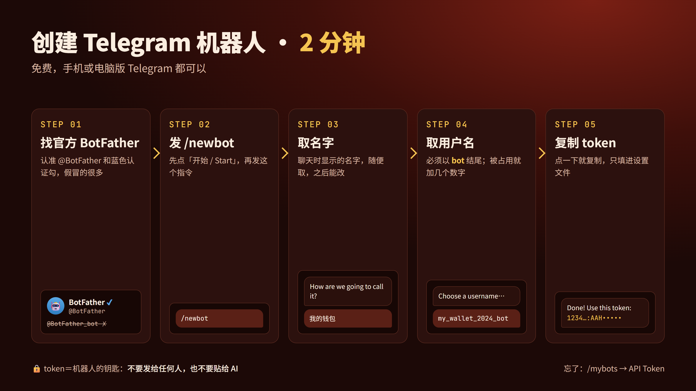

# 完整教程：用 Telegram 操作币安 AI 钱包

从零开始，把 agent-wallet-tg 装好、连上钱包、买第一笔。没写过代码也能照着做，大约 30 分钟。

> 💡 **不想自己敲命令？** 把 [INSTALL_WITH_AI.md](../INSTALL_WITH_AI.md) 发给你的 AI 助手，说「一步一步帮我安装」，它会带你做完。

> ⚠️ 本软件操作的是真实资金，未经第三方审计。土狗币可能归零，请从小金额开始。教程里的币和金额都只是示范，不构成投资建议。


## 目录

0. [开始前](#0-开始前)
1. [它怎么运作](#1-它怎么运作)
2. [安装工具](#2-安装工具)
3. [创建 Telegram 机器人](#3-创建-telegram-机器人)
4. [下载并填设置](#4-下载并填设置)
5. [第一次启动](#5-第一次启动)
6. [连接 AI 钱包](#6-连接-ai-钱包)
7. [第一次买币](#7-第一次买币)
8. [卖出、挂单、止盈止损](#8-卖出挂单止盈止损)
9. [内盘币和 Agent ID](#9-内盘币和-agent-id)
10. [项目合约：铸造、领取、预售、照抄](#10-项目合约铸造领取预售照抄)
11. [新盘狙击](#11-新盘狙击)
12. [设置、快捷键、自动转出](#12-设置快捷键自动转出)
13. [更新、停止、移除](#13-更新停止移除)
14. [安全清单](#14-安全清单)

遇到问题先看 [常见问题 FAQ](FAQ.zh-CN.md)。

---

## 0. 开始前

**你需要：**

- [ ] 一台电脑：Windows 10/11、macOS 或 Linux（手机跑不了，手机只用来操作 Telegram）
- [ ] 一个币安账号，并在币安 App 的 Web3 钱包里开通 **AI 钱包（Agentic Wallet）**
- [ ] Telegram
- [ ] 少量 BNB（BSC 链），先拿来测试

**名词小词典：**

| 名词 | 意思 |
|---|---|
| 终端 | 打命令的黑色窗口。Windows 是「Ubuntu」，macOS 是「终端 / Terminal」 |
| BSC / BNB | 币安智能链 / 这条链上的币。买币和手续费都用 BNB |
| gas | 链上手续费，用 BNB 付 |
| 代币地址 / 合约地址 | `0x` 开头的 42 位字符串，每个币、每个项目都有一个 |
| 外盘 / 内盘 | 已上 PancakeSwap 的币 / 还在发射台曲线上、没毕业的币 |
| 滑点 | 下单到成交之间价格可以偏多少 |
| token（机器人） | Telegram 机器人的钥匙，**不要给任何人** |
| env 文件 | 机器人的设置文件，在 `~/.config/agent-wallet-tg/env` |

**终端怎么用：**

- 复制教程里的一整块命令 → 在终端里粘贴 → 按 **回车**。等最后一行重新出现 `$` 才算做完。
- 粘贴：Ubuntu 窗口点**鼠标右键**（或 `Ctrl+Shift+V`）；macOS 按 `Cmd+V`。
- 要求输入密码（`[sudo] password`）时，**打字不会显示**，这是正常的，打完按回车。
- `#` 后面是说明，跟着粘贴进去也没关系。

## 1. 它怎么运作

```
你（Telegram）  ──>  机器人（你电脑上的 bot.py）  ──>  baw 命令行  ──>  币安 AI 钱包（签名、上链）
```

- **跑在你自己的电脑上**，不是别人的服务器。代码全部公开。
- **私钥在币安那边**。机器人只调用币安官方的 `baw` 工具，看不到私钥和助记词。
- **每一笔都要你按确认**。先报价或链上模拟给你看，你按 ✅ 才送出。
- **只认你一个人**。别人发消息给你的机器人，它一律不理。


## 2. 安装工具

### Windows：先装 WSL2（Ubuntu）

1. 开始菜单搜索 **PowerShell** → 右键 → **以管理员身份运行**。
2. 粘贴并回车：
   ```powershell
   wsl --install
   ```
3. 装完**重启电脑**。重启后会自动打开 Ubuntu 窗口（没有的话，开始菜单搜索 **Ubuntu** 打开）。
4. 按提示设一个用户名（英文小写）和密码。密码打字不会显示，记好它，之后 `sudo` 要用。

**之后所有命令都在 Ubuntu 窗口里执行。**

### Windows（Ubuntu 里）/ Linux：装 4 个工具

```bash
sudo apt update && sudo apt install -y curl git python3
curl -fsSL https://deb.nodesource.com/setup_20.x | sudo -E bash -
sudo apt install -y nodejs
sudo npm install -g @binance/agentic-wallet
curl -L https://foundry.paradigm.xyz | bash
```

会滚出很多文字，正常。做完后**关掉终端，重新打开**，再执行：

```bash
foundryup
```

### macOS：装 4 个工具

先装 [Homebrew](https://brew.sh)（已装过就跳过），再执行：

```bash
brew install node git python
npm install -g @binance/agentic-wallet
curl -L https://foundry.paradigm.xyz | bash
```

关掉终端重新打开，再执行 `foundryup`。

### 检查

```bash
python3 --version
node --version
baw --version
cast --version
```

**应该看到：** Python `3.10` 以上、Node `18` 以上，`baw` 和 `cast` 各显示一个版本号。

| 看到 | 怎么办 |
|---|---|
| Python 是 3.9 或更旧 | macOS：`brew install python` 后重开终端。Ubuntu 20.04：在 PowerShell 执行 `wsl --install -d Ubuntu-24.04`，改用新的 |
| `baw: command not found` | 重新执行 `sudo npm install -g @binance/agentic-wallet`（macOS 不用 `sudo`） |
| `cast: command not found` | 重开终端后执行 `foundryup`；还不行就执行 `~/.foundry/bin/foundryup` |

## 3. 创建 Telegram 机器人

免费，约 2 分钟，手机或电脑版 Telegram 都行。



1. **找官方 BotFather**：搜索 `BotFather` 或打开 [t.me/BotFather](https://t.me/BotFather)。认准用户名**正好是 `@BotFather`**、有**蓝色认证勾**。`BotFather_bot` 之类都是假冒的。
2. 点 **开始 / Start**，发送 `/newbot`。
3. 它问名字（*How are we going to call it?*）：随便取，例如 `我的钱包`，之后能改。
4. 它问用户名（*choose a username*）：英文字母、数字、`_`，**必须以 `bot` 结尾**，例如 `my_wallet_2024_bot`。显示 *already taken* 就加几个数字再试。
5. 成功后它回 *Done! Congratulations...*：
   - `t.me/你的用户名`：你的机器人，第 5 节会用到
   - *Use this token to access the HTTP API:* 下面那串 `1234567890:AAH...` 就是 **token**，点一下就复制

> 🔒 **token 不要发给任何人、不要贴到群里、也不要贴给 AI 助手**，只填进第 4 节的设置文件。
> 忘了：对 BotFather 发 `/mybots` → 选机器人 → **API Token**。外泄了：同一页按 **Revoke current token** 换新的。

## 4. 下载并填设置

```bash
cd ~
git clone https://github.com/Cryptozwm/agent-wallet-tg.git
cd agent-wallet-tg
mkdir -p ~/.config/agent-wallet-tg
cp env.example ~/.config/agent-wallet-tg/env
chmod 600 ~/.config/agent-wallet-tg/env
nano ~/.config/agent-wallet-tg/env
```

最后一行会打开文字编辑器 nano。用方向键移动光标，改这两行：

```ini
TG_BOT_TOKEN=粘贴你的 token（等号后面不要空格、不要引号）
BOT_LANG=zh
```

`TG_OWNER_ID=` 先留空。**存档：** `Ctrl+O` → 回车；**离开：** `Ctrl+X`。

其他设置先用默认值，之后都能改（改完要重启机器人）：

| 设置 | 默认 | 意思 |
|---|---|---|
| `MAX_BNB_PER_WALLET` | 0.1 | 单一钱包每次最多花多少 BNB。**只能在这里改**，Telegram 改不了 |
| `SLIPPAGE` | auto | 滑点，auto 由币安决定 |
| `BLOCK_RISK_LEVEL` | 4 | 安全检查风险等级到这个数就拒绝买入（4 = 高风险） |
| `MIN_LIQUIDITY_USD` | 20000 | 池子小于这个美元数，要多按一次「仍要买」 |
| `CONFIRM_TTL_SECONDS` | 90 | 预览多少秒后失效 |
| `TZ_OFFSET_HOURS` | 8 | 显示时间用的时区（8 = 北京时间） |
| `RPC_URL` | 公共节点 | 读链上数据的节点，慢的话换自己的 |


## 5. 第一次启动

```bash
cd ~/agent-wallet-tg
./run.sh
```

**应该看到：** `bot running (Ctrl+C to stop)`。这个窗口**不要关**，关了机器人就停了。

| 看到 | 怎么办 |
|---|---|
| `TG_BOT_TOKEN is missing` | token 没存进去，回第 4 节重新编辑、记得 `Ctrl+O` 存档 |
| `Permission denied` | 执行 `chmod +x run.sh`，再 `./run.sh` |
| `warning: baw not found` | 回第 2 节装 baw |
| `bot is already running` | 已经有一个在跑了，不用再开 |

**设置主人（只做一次）：**

1. Telegram 打开 `t.me/你的用户名`，点 **开始 / Start**，随便发一句话。
2. 它回：「你的 Telegram ID 是 123456789…」。
3. 回到终端按 `Ctrl+C` 停掉机器人，填 ID：
   ```bash
   nano ~/.config/agent-wallet-tg/env
   ```
   把数字填在 `TG_OWNER_ID=` 后面 → `Ctrl+O` 回车 → `Ctrl+X`。
4. 再启动：`./run.sh`
5. Telegram 发 `/start`，**应该看到**主菜单：

```
👋 AI 钱包机器人（还没有钱包，先到钱包状态添加）

直接贴给我就好，不用打指令：
🪙 代币地址 → 交易卡片（买、卖、挂单、止盈止损）
📜 项目合约地址 → 动作按钮（铸造、领取、退款…）
📋 项目给 agent 的整段说明 → 预售卡片
🔁 别人成功的交易 hash → 照抄一笔
```

没反应？看日志：`tail -20 ~/.config/agent-wallet-tg/stdout.log`。有 `401 Unauthorized` 就是 token 填错了。

**让它一直在后台跑（可选）：**

- **Windows 开机自启**：先按 `Ctrl+C` 停掉，再执行 `cd ~/agent-wallet-tg && explorer.exe .`，在打开的文件夹里右键 `install-task.ps1` →「使用 PowerShell 运行」。之后开机就会自己在后台跑，不会有窗口。出现「拒绝访问」看 [FAQ](FAQ.zh-CN.md#安装与启动)。
- **macOS / Linux**：执行 `tmux new -s bot`，再 `./run.sh`，然后按 `Ctrl+B` 再按 `D` 离开，窗口可以关。回去看：`tmux attach -t bot`。

## 6. 连接 AI 钱包

1. 在机器人按 **📊 钱包状态 → ➕ 添加钱包**。
2. 它会给你一个登录链接和一组**配对码**。
3. 打开链接，在币安 App 里确认。**App 上的配对码要跟机器人给的一样**，不一样就不要确认。
4. 5 分钟内确认完，机器人回「✅ 钱包 A 已加入」和钱包地址。

**再加钱包 B、C…：** 换**另一个币安账号**，再按一次「➕ 添加钱包」。

**充 BNB：** 把 BNB 转到机器人显示的地址，网络一定要选 **BSC / BNB Smart Chain**，选错链会丢钱。每个钱包会自动留 0.002 BNB 当手续费。

**开发者模式：** 买内盘币、调用项目合约要用。在币安 App 的 AI 钱包设置里打开。它有到期时间，**📊 钱包状态 → 详细** 看得到，过期了再打开一次。只买外盘币不需要。

**登录过期：** 机器人提示「登录过期」时，按 **🔑 重新登录**，在币安 App 确认一次就好。

## 7. 第一次买币

1. 把**代币地址**（`0x…`）直接贴给机器人。
2. 机器人回一张**交易卡片**：价格、市值、池子、持有人、前十持仓、买卖税、安全检查，以及你各钱包的持仓。
3. 按一个买入按钮：
   - `买 0.01` / `买 0.03` / `买 0.05`：每个钱包各花这么多 BNB
   - `买 1%` / `买 5%`：每个钱包用自己 BNB 余额的几 %
   - `买 x ✏️`：自己打金额
4. 机器人给你**预览**：每个钱包花多少 BNB、预计拿到多少币、滑点。
5. 没问题就按 **✅ 确认买入**；不买就按 **❌ 取消**，或放着 90 秒自己失效。
6. 成交后机器人回报数量和交易链接。

> 价格很小的币写成 `0.0(4)52`，意思是小数点后 4 个 0，也就是 0.000052。

**被拒绝的常见原因：**

- 安全检查风险太高：直接拒绝。
- 池子太小：会多一个 **🔓 这颗仍要买（30 分钟）** 按钮。
- 超过单一钱包上限：只能在电脑上改 `MAX_BNB_PER_WALLET`。
- 「链上试跑失败」：送出前模拟过会失败，所以什么都没送。括号里是原因。

## 8. 卖出、挂单、止盈止损

**卖出：** 卡片上按 `🔴 卖 50%`、`🔴 卖 100%`，或 `🔴 卖 x% ✏️` 自己打比例。一样先预览，再按 **✅ 确认卖出**。

**限价挂单：** 按 `📌 挂单` → `限价买 ✏️` 或 `限价卖 ✏️`，打目标价格。挂单**由币安托管**，到价自动成交，机器人关了也有效。主菜单 **📌 挂单** 可以查看、撤单。

**止盈止损：** 按 `🎯 止盈止损` → `➕ 止盈 ✏️` 或 `➕ 止损 ✏️`，例如「涨 100% 卖 50%」「跌 30% 卖 100%」。

- 机器人**每 20 秒**检查一次，碰到条件就**自动卖，不再问你**（设置时已确认过）。
- **机器人要在跑才会检查**，电脑关机或睡眠就不会卖。
- 每次买完自动挂上：**⚙️ 设置 → 🎯 自动止盈止损**。

## 9. 内盘币和 Agent ID

还没毕业的币（在发射台曲线上），币安一般兑换买不到。机器人会自动认出是哪个发射台，**直接跟曲线买卖**，卡片和按钮跟外盘一样。毕业后自动改走 PancakeSwap。

支持：Four.meme（含 Agent 专属盘）、Flap（含门槛盘）、Agent Curve、gang.fun V1–V3。

- 内盘一定要先打开**开发者模式**（第 6 节）。

**Agent ID：** 币安 AI 钱包可以领的 `.ai` 身份（链上是一个 NFT）。Four.meme 的 Agent 专属盘、Flap 的 Agent ID 门槛盘、Agent Curve 只让有 Agent ID 的钱包买。

- **📊 钱包状态** 会显示每个钱包有没有；终端执行 `baw wallet agent-id` 也能查。
- 在币安 App 的 AI 钱包里领取。
- **每个钱包都要有自己的**。A 有、B 没有，B 照样买不了，预览里会标出来。

## 10. 项目合约：铸造、领取、预售、照抄

**贴项目合约地址：** 机器人列出合约能做的动作（铸造、领取、退款、质押…），每个动作一个按钮。按下去会一步步问你要填什么，最后**先在链上模拟**，你按 **✅ 确认送出** 才送。

- **mint NFT** 也这样做（限 BSC）。白名单盘要一串证明（proof）或签名，从项目网站拿到再填。
- mint 到的 NFT 不会显示在机器人持仓里，用钱包地址到 BscScan 查。

**贴项目给 agent 的说明：** 很多项目会写一段「给 AI agent 的说明」。整段贴给机器人，直接生成预售 / 铸造卡片。

**照抄别人的一笔：** 把别人成功 mint 或领取的交易 hash 贴过来（或 `/copy 交易hash`），机器人把里面的地址换成你的，生成一样的预览。确认前看清楚花多少、给谁。

**进阶指令：**

| 指令 | 用途 |
|---|---|
| `/tx AB 0x… claim(address) 我` | 直接调用合约函数；「我」＝自己的地址；要付 BNB 最后加「付 0.01」 |
| `/max AB 0x… mint(uint256) ? value=?x0.0032` | 数量打 `?`，试出最多能买多少 |
| `/rules 0x…` | 读出合约里跟上限、价格、时间、名额有关的设置 |
| `/fn 0x…` | 列出合约的函数 |

## 11. 新盘狙击

主菜单按 **⚡ 新盘狙击**。它监听新开的盘，符合条件就买。

- **默认是模拟**，只回报「如果是真的会买哪颗」，不动钱。先看几天。
- 要真买：按 **⚡ 改成真的下单** 并确认。之后符合条件就**直接买，不再问你**。
- 可以设：哪些发射台、每个钱包买多少、每天最多花多少 BNB、每天最多几颗、太晚发现就跳过。
- 买到后自动盯盘，例如涨到 2 倍卖 50%、跌 50% 全卖。

## 12. 设置、快捷键、自动转出

**⚙️ 设置** 里可以改：快捷买金额、比例买、快捷卖比例、默认用哪几个钱包、滑点、池子门槛、自动止盈止损。

**📤 自动转出：** 卖出后把利润转回主钱包。主钱包地址**只能在电脑上**填：`~/.config/agent-wallet-tg/wallets.json` 的 `payout`（格式照 `wallets.example.json`），而且要先把这个地址加进币安 App 的地址簿。

**快捷键：** 预览上按「⭐ 存成快捷键」，或 `/key 名字 指令`，会出现在输入框下方。`/key 名字` 删除。

**全部指令：** 主菜单按 **📖 全部指令**。

## 13. 更新、停止、移除

**更新到新版：**

```bash
cd ~/agent-wallet-tg
git pull
pkill -f "python3 -u bot.py"   # run.sh 会在 10 秒后用新版重开
```

设置和钱包都在 `~/.config/agent-wallet-tg/`，更新不会动到。

**停止：** 在 `run.sh` 窗口按 `Ctrl+C`。开了 Windows 自启的，在 PowerShell 执行 `Unregister-ScheduledTask -TaskName agent-wallet-tg -Confirm:$false` 取消。

**移除：** 停止后删掉 `~/agent-wallet-tg` 和 `~/.config/agent-wallet-tg/`，再对 BotFather 发 `/deletebot`。币安 AI 钱包和里面的钱不受影响。

## 14. 安全清单

- [ ] token 只在 env 文件里，没发给任何人
- [ ] `TG_OWNER_ID` 是你自己的 ID
- [ ] `MAX_BNB_PER_WALLET` 是你亏得起的金额
- [ ] 每次按确认前看过预览：花多少、拿到什么、给谁
- [ ] 自动功能（止盈止损、狙击真单、自动转出）清楚规则才开
- [ ] 任何人（包括 AI）问你要私钥、助记词、密码，都不给
- [ ] 土狗币风险很高，只用小钱

还有问题？看 [常见问题 FAQ](FAQ.zh-CN.md)。
